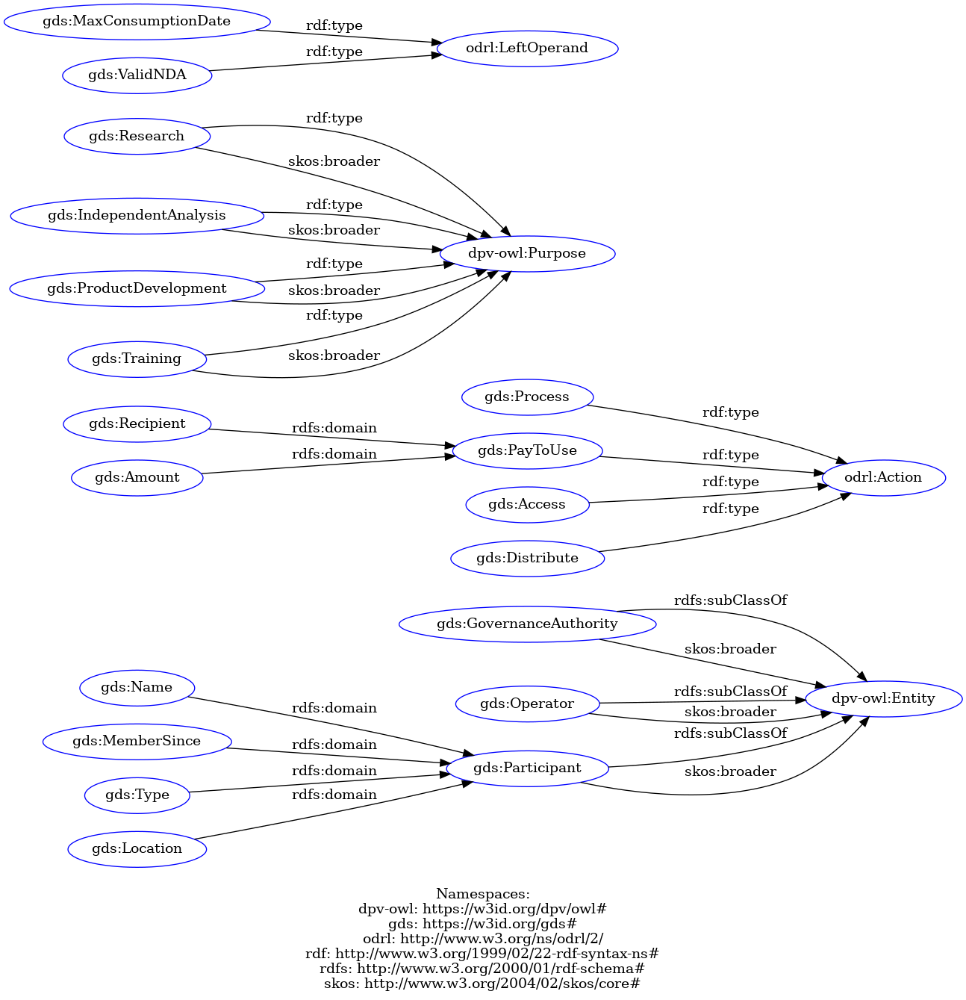

# GATE Data Spaces ODRL Profile

**Version:** 0.1.0  
**Status:** Experimental  
**Maintainer:** GATE Institute

## Overview

The GATE Data Spaces ODRL Profile extends the W3C Open Digital Rights Language (ODRL) with vocabulary terms for expressing policies in data-space environments.

The profile defines domain-specific concepts and reuses existing semantic vocabularies where appropriate.

## Persistent Identifiers

- **Profile:** https://w3id.org/gds/profile
- **Vocabulary namespace:** https://w3id.org/gds#
- **Version 0.1.0:** https://w3id.org/gds/profile/v0.1.0

## Machine-Readable Specification

The profile is available in Turtle (RDF):

[View the Turtle specification](https://gate-institute.github.io/gateds-ontologies/gds/versions/v0.1.0/gds.ttl)

## Versioning

This is an experimental release. The vocabulary and its semantics may evolve in subsequent versions.

Previous releases are preserved in the `versions/` directory.

